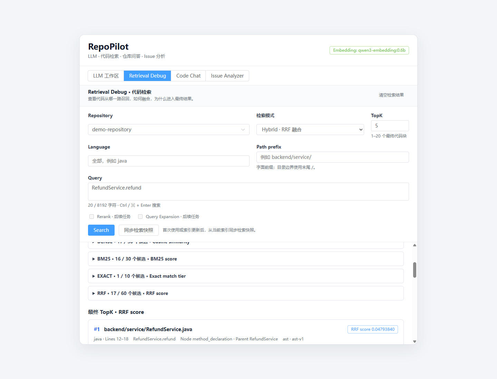

# Stage 4 / Task 9：可解释的 Retrieval Debug

2026-10-31 完成页面与真实接口接入。现在可以选择 Dense、BM25 或 Hybrid，查看各通道召回、融合与最终排名，按语言和路径前缀限制范围，并展开代码、Exact 原因和 RRF 贡献。Code Chat、Issue Analyzer 和既有 `/api/retrieval/search` 继续使用原 Dense 路径。

## 页面使用

启动现有 Ollama、Qdrant 和开发服务后，打开 `http://localhost:5173/#retrieval`。首次使用某仓库或更新索引后，点击“同步检索快照”，再输入问题搜索。同步从已有 Qdrant Point 派生本地词法快照，预先声明完整 Chunk 清单，并在发布前后检查索引一致性；同步本身没有 Embedding 或生成调用。

快照保存在 `.tools/retrieval-debug/snapshots.sqlite3`。缺失、正在同步、重建未完成或相对 Dense 失效的快照返回受控 409；页面提示显式同步。失败后不会自动使用旧快照。同步与现有索引接口在单个 API 进程内共享 `indexing_guard`，并使用 Task 5 的快照租约和前后校验。多进程索引写入与外部 ABA 的边界仍沿用 Task 5，当前按一个 API worker 运行。

Language 使用小写索引语言名，空值代表全部。Path prefix 使用区分大小写的字面前缀；例如 `backend/service/` 带目录边界。过滤在三个通道各自排名、截断之前执行。TopK 为 1–20，内部上限仍为 Dense 30 / BM25 30 / Exact 10 / 融合 60。

候选表同时展示通道排名、明确的分数类别、融合排名、最终排名、真实文件/行范围、Symbol、Node Type、Parent Symbol 和 Chunk UUID。融合池中的每个候选直接列出原通道排名与原始分数；最终结果还可展开 `1/(60+rank)` 的贡献及代码。RRF 只融合排名；Cosine、BM25、Exact 档位和 RRF 分数都不是答案可信度。

页面显示完整索引快照 SHA-256，而非原生索引修订号。它指向被检索的索引映像，源码修改后需按现有流程重新索引。输入参数改变后，旧结果会明确标为先前参数。取消会释放控件并丢弃迟到结果；180 秒超时也使用同一请求身份保护。

Rerank、Query Expansion 开关已预留且禁用，接口拒绝开启它们。Debug 不构建生成 Context，也不调用生成模型。RAG 原有的 5 Sources / 16000 字符预算继续由原端点管理。页面的范围指纹校验使用 WebCrypto，请使用 localhost 或 HTTPS。

## 新增接口与契约

`POST /api/retrieval/debug/snapshot`：

```json
{"repository":"demo-repository"}
```

返回 repository、collection、index_revision、Chunk 数和同步耗时。它只更新本地词法快照，Qdrant 数据保持原样。

`POST /api/retrieval/debug`：

```json
{
  "repository":"demo-repository",
  "query":"RefundService.refund",
  "top_k":5,
  "mode":"hybrid",
  "filters":{"language":"java","path_prefix":"backend/service/"},
  "rerank":false,
  "query_expansion":false
}
```

返回既有来源字段及 mode、score_type、filters、index_revision、固定候选上限、channels、fused、RRF 贡献与 timings。分数类别分别为 `cosine_similarity`、`bm25`、`rrf`；Exact 候选保留匹配档位及 full/partial reason。模型名和维度描述被查询的索引；BM25 查询没有 Embedding 调用。

后端 [`DebugSearchResponse`](../services/api/app/schemas/retrieval_debug.py) 重算融合与最终结果，验证范围、版本、来源、排名和耗时边界。[前端解析器](../apps/web/src/api/retrieval-debug-contract.ts) 独立核对请求回显、范围 SHA、源码实际行数、Exact 字符坐标、身份冲突、RRF 贡献及 TopK 前缀，投影已知字段后渲染。代码通过文本插值展示。

非法请求返回安全 422，快照状态冲突返回 409，检索/来源校验失败返回 502，依赖或本地存储不可用返回 503。错误不会返回部分候选、上游 Payload 或本地存储路径；客户端错误文案区分这些情况。

## 真实验证与证据

正式 API 报告为 [`stage4_debug_20261031_task9_release.json`](../evaluation/reports/stage4_debug_20261031_task9_release.json)。它保留九个 HTTP 场景、逐次真实查询向量、完整索引读前/读后快照、请求与回复，以及实现关联指纹：

| 场景 | 实际 HTTP | 查询 Embedding | 结果 |
| --- | ---: | ---: | --- |
| Dense | 200 | 1 | Top5，Cosine 类型 |
| BM25 | 200 | 0 | Top5，BM25 类型 |
| Hybrid | 200 | 1 | 三路候选及 RRF Top5 |
| java AND backend/service/ | 200 | 1 | 各路候选均在过滤范围 |
| 无合格语言范围 | 200 | 0 | 空候选 |
| 无词法 Token | 200 | 0 | BM25 空候选 |
| 未准备快照的仓库 | 409 | 0 | 安全失败 |
| 开启未来功能 | 422 | 0 | 请求被拒绝 |
| 原 Dense 搜索接口 | 200 | 1 | Top5 源码及顺序与新 Dense 相同 |

另有一次显式同步成功。两次独立真实 Embedding 返回了不同向量，新旧 Dense 的原始分数因此不完全相同；最大观测差约 0.00172。每条原始分数都用该次保存向量独立重算，兼容性比较的是源码身份、坐标和顺序。没有强制覆盖分数、重试挑选结果或调整模型。

浏览器额外使用五次真实 Embedding，整个验收共九次，生成调用为零。Playwright 实际验证了三种模式、过滤、空结果、候选代码与 RRF 贡献展开、非法过滤提示、移动布局和迟到响应。迟到测试只为首个真实 Hybrid 请求忽略 AbortSignal 并延迟交付；取消后发出 BM25 请求，旧回复随后真实到达，页面仍保留 BM25 结果且控件可用。测试拦截器已通过刷新清除，验证用 API 已恢复为普通服务。

[浏览器验收清单](../output/playwright/stage4-task9/browser-verification-final.json) 保存断言、截图和原始命令输出。桌面及 390px 页面均无横向溢出；浏览器控制台错误为零。



`RefundService.refund:12–18` 是一次真实展示：Dense 原排名 6，BM25 与 Exact 均为 1，RRF 最终为 1；贡献为 `1/66 + 1/61 + 1/61 = 0.04793840`。它说明这条结果的来源与排名，不构成新的质量评测或答案正确性结论。Task 8 的历史退化和负例仍保留，20 条保留问题未查询。

本轮真实服务内耗时约为 Dense 8563 ms、BM25 5439 ms、Hybrid 22408 ms。各通道与外层守卫重复读取完整索引进行校验，协调与校验占据显著时间；这些是当前实验实现的实测值，尚未优化为产品延迟。页面分别显示通道、融合、额外协调与总耗时，没有把纯 RRF 计算时间当成整次检索耗时。

## 复现与保留策略

```powershell
# 普通开发服务，模型和索引按现有 README 准备
.\Start-RepoPilot.ps1 -NoBrowser

# 离线重算本轮 HTTP 收据，无需模型、Qdrant 或浏览器
& '.\services\api\.venv\Scripts\python.exe' evaluation/stage4/verify_debug.py `
  --verify-only evaluation/reports/stage4_debug_20261031_task9_release.json

Push-Location services/api
& '.\.venv\Scripts\python.exe' -m pytest -q
Pop-Location
& '.\services\api\.venv\Scripts\python.exe' -m pytest evaluation/tests -q
Push-Location apps/web
npm test
npm run build
Pop-Location
```

重新运行真实 API 验收时，保持保护清单中的索引/配置，使用独立验证会话在端口 8000 运行 [`serve_api.py`](../output/stage4-task9/serve_api.py)，再执行 `verify_debug.py --output <新路径>`。这个验证入口记录实际查询向量并禁止生成，验证后切回普通服务。已有报告/收据目录拒绝覆盖，发生状态漂移会中止，不自动重索引。

首次启动验证辅助程序时，工厂类名导入写错，启动日志和未完成目录保留；随后修正辅助程序及本地 HTTP 代理绕过。离线校验还修正了“独立 Embedding 的原始分数必须完全相等”的错误假设，原始向量和回复均保留。

页面最终复核补回 Node Type / Parent Symbol，并补齐融合池每个候选的来源显示。正式 release 清单原样复用此前成功的全部九条 HTTP 收据，只更新两个渲染组件的关联；旧组件字节快照、旧报告和逐案 SHA-256 均保留，新增模型调用为零。API、契约、数据或索引变更不能使用这条渲染重绑定路径。

新增 25 项后端测试，当前 **1279 通过、6 跳过**；新增 17 项评测收据测试，**207 通过**；新增 30 项前端契约/状态测试，**76 通过**，类型检查与生产构建成功。两项既有后端依赖弃用警告保留。

[机器验收](stage-4-task-9-verification.json) 核对 1227 个实施前文件；六个计划内文件更新，其余 1221 个指纹一致。实际 `.env`、锁文件、旧数据集、旧评测产物和两个既有 Qdrant Collection 的完整配置/Metadata/Payload/Vector 均未变化。Task 1–8 的离线证据继续可重算。

下一任务是 Task 10：Reranker Adapter 与有限候选重排。Expansion、Context Selection 以及 Code Chat/Issue 的 Hybrid 产品接入仍在后续任务。
